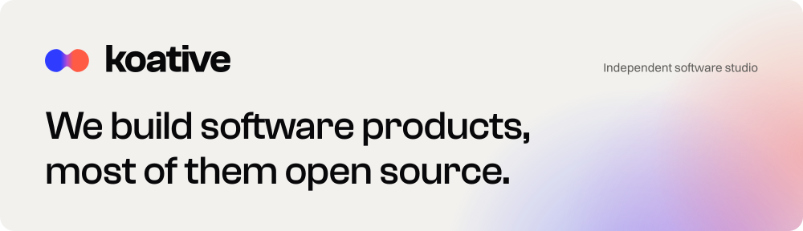

<a href="https://koative.com">
  <picture>
    <source media="(prefers-color-scheme: dark) and (max-width: 600px)" srcset="https://raw.githubusercontent.com/koative/.github/main/assets/koative-header-dark-mobile.svg" />
    <source media="(max-width: 600px)" srcset="https://raw.githubusercontent.com/koative/.github/main/assets/koative-header-light-mobile.svg" />
    <source media="(prefers-color-scheme: dark)" srcset="https://raw.githubusercontent.com/koative/.github/main/assets/koative-header-dark.svg" />
    
  </picture>
</a>

koative is an independent software studio, a US company. We also take on a few client projects a year.

| Product | What it is | Links |
| :-- | :-- | :-- |
| 🍎 **OpenMacApps** | An app-store-style catalogue of 1,000+ open-source Mac apps. | [Website](https://openmacapps.com) · [Source](https://github.com/koative/openmacapps) |
| 🪣 **Bucketdeck** | A native macOS app for Amazon S3 and S3-compatible storage. In beta. | [Website](https://bucketdeck.com) · [Source](https://github.com/koative/bucketdeck) |
| 💯 **Cento** | 100 complete, multi-page website templates, free to take. | [Website](https://cento.koative.com) · [Source](https://github.com/koative/cento) |
| 🖼️ **Rast** | Compress images in the browser and compare every format side by side. | [Website](https://rast.koative.com) · [Source](https://github.com/koative/rast) |
| 🐹 **hyperliquid-go** | A Go SDK for the Hyperliquid API. | [Website](https://hyperliquid-go.koative.com) · [Source](https://github.com/koative/hyperliquid-go) |

[koative.com](https://koative.com) · [Start a project](https://koative.com/contact/) · [LinkedIn](https://www.linkedin.com/company/75442995/)
